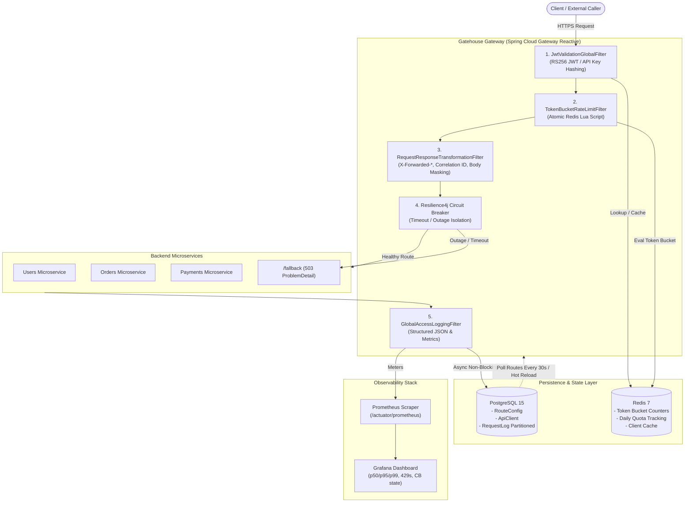

# Gatehouse Gateway

[](https://github.com/crnjihia/gatehouse-gateway)
[](https://spring.io/projects/spring-boot)
[](https://spring.io/projects/spring-cloud-gateway)
[](https://openjdk.org/)
[](LICENSE)

**Gatehouse Gateway** is an enterprise-grade, high-throughput, reactive API gateway built on **Spring Cloud Gateway**, **Project Reactor**, **Netty**, **Redis 7**, and **PostgreSQL 15**. It delivers non-blocking request routing, per-client RS256 JWT validation, atomic Redis Token-Bucket rate limiting, dynamic database-backed routing without restarts, PCI-compliant response body masking, Resilience4j circuit breaking, and end-to-end Prometheus/Grafana observability.

---

## Architecture Diagram



---

## Core Features

- **Dynamic Routes from PostgreSQL**: Route definitions (predicates, filters, orders, and URIs) are stored in Postgres as JSONB. Routes are polled every 30 seconds and can be hot-reloaded on-demand via `POST /admin/routes/reload` without zero gateway downtime or server restarts.
- **Per-Client RS256 JWT & API Key Validation**:
  - Validates `Authorization: Bearer <token>` against RS256 public keys (PEM or JWKS).
  - Validates `iss`, `aud`, and `exp` claims.
  - Injects downstream context headers: `X-Client-Id`, `X-Client-Scopes`, `X-Request-Id`.
  - Supports `X-API-Key` authentication with SHA-256 hashed keys and sub-millisecond Redis cache.
  - Rejects unauthenticated traffic with RFC 7807 `ProblemDetail` JSON.
- **Token-Bucket Rate Limiter & Daily Quotas (Redis Lua)**:
  - Atomic Redis script verifies and decrements both minute rate limit tokens and daily quota counters in a single roundtrip.
  - Exposes standard response headers: `X-RateLimit-Limit`, `X-RateLimit-Remaining`, `X-RateLimit-Reset`.
  - Rejection on breach: Returns HTTP `429 Too Many Requests` with `Retry-After` header.
- **Request / Response Transformation & PII/PCI Masking**:
  - Injects correlation ID (`X-Request-Id`) across request, response, and logs.
  - Rewrites `X-Forwarded-*` headers (`X-Forwarded-For`, `X-Forwarded-Proto`, `X-Forwarded-Host`).
  - Masks sensitive headers (`Authorization`, `Cookie`, `X-API-Key`) in structured logs.
  - Reactive response body masking using Jackson and `ModifyResponseBodyGatewayFilterFactory` for sensitive fields (`$.cardNumber`, `$.cvv`, `$.password`, `$.ssn`).
- **Resilience4j Circuit Breaking & Retries**:
  - Configured per route (`slidingWindowSize=20`, `failureRateThreshold=50%`, `waitDurationInOpenState=15s`, `permittedNumberOfCallsInHalfOpenState=5`).
  - Graceful fallback endpoint `/fallback` returning RFC 7807 HTTP 503 `ProblemDetail`.
  - Exponential backoff retry (100ms -> 200ms -> 400ms, max 3 attempts) on 5xx and timeouts for idempotent HTTP methods (`GET`, `PUT`, `DELETE`).
- **Full Observability & Partitioned Database Ingestion**:
  - Micrometer metrics exposed at `/actuator/prometheus`:
    - `gateway.requests.total{route, method, status}`
    - `gateway.request.duration` (histogram with p50, p95, p99 percentiles)
    - `gateway.ratelimit.rejected{clientId}`
    - `gateway.circuitbreaker.state{route}`
  - Structured JSON access logging with MDC correlation.
  - Partitioned PostgreSQL `request_logs` table partitioned by month with non-blocking async persistence.

---

## Rate Limit Plan Table

Rate limits and quotas are bound to the client tier in `api_clients` or overridden per client:

| Plan | Rate Limit (Tokens / Min) | Daily Quota (Requests / Day) | Burst Capacity | Cost / Target Tier |
| :--- | :---: | :---: | :---: | :--- |
| **FREE** | `60 req/min` | `1,000 req/day` | 60 | Hobbyists, Evaluators |
| **PRO** | `600 req/min` | `100,000 req/day` | 600 | Growth Startups, High Volume |
| **ENTERPRISE** | `6,000 req/min` | `1,000,000 req/day` | 6000 | Mission-Critical Enterprise |

---

## Route Configuration Examples

Routes are loaded dynamically from `route_configs`. You can create, update, or remove routes via the Admin API without restarting the gateway.

### Example 1: Users Service (Path Predicate, Circuit Breaker, Token Bucket, Masking)
```json
{
  "routeId": "users-service",
  "uri": "http://wiremock:8080",
  "predicates": "[{\"name\": \"Path\", \"args\": {\"pattern\": \"/api/v1/users/**\"}}]",
  "filters": "[{\"name\": \"StripPrefix\", \"args\": {\"parts\": \"2\"}}, {\"name\": \"CircuitBreaker\", \"args\": {\"name\": \"usersCircuitBreaker\", \"fallbackUri\": \"forward:/fallback\"}}, {\"name\": \"TokenBucketRateLimit\", \"args\": {}}, {\"name\": \"RequestResponseTransformation\", \"args\": {\"maskFields\": \"$.password,$.ssn\"}}]",
  "routeOrder": 1,
  "enabled": true,
  "description": "Users microservice with token-bucket rate limiting and PII masking"
}
```

### Example 2: Orders Service with Idempotent Retry & Circuit Breaker
```json
{
  "routeId": "orders-service",
  "uri": "http://wiremock:8080",
  "predicates": "[{\"name\": \"Path\", \"args\": {\"pattern\": \"/api/v1/orders/**\"}}, {\"name\": \"Method\", \"args\": {\"methods\": \"GET,POST,PUT,DELETE\"}}]",
  "filters": "[{\"name\": \"StripPrefix\", \"args\": {\"parts\": \"2\"}}, {\"name\": \"CircuitBreaker\", \"args\": {\"name\": \"ordersCircuitBreaker\", \"fallbackUri\": \"forward:/fallback\"}}, {\"name\": \"TokenBucketRateLimit\", \"args\": {}}, {\"name\": \"Retry\", \"args\": {\"retries\": 3, \"series\": \"SERVER_ERROR\", \"methods\": \"GET,PUT\", \"backoff\": {\"firstBackoff\": \"100ms\", \"maxBackoff\": \"400ms\", \"factor\": 2}}}]",
  "routeOrder": 2,
  "enabled": true,
  "description": "Orders microservice with exponential backoff retry on idempotent methods"
}
```

### Example 3: Payments Service (PCI-DSS Credit Card Masking)
```json
{
  "routeId": "payments-service",
  "uri": "http://wiremock:8080",
  "predicates": "[{\"name\": \"Path\", \"args\": {\"pattern\": \"/api/v1/payments/**\"}}]",
  "filters": "[{\"name\": \"StripPrefix\", \"args\": {\"parts\": \"2\"}}, {\"name\": \"CircuitBreaker\", \"args\": {\"name\": \"paymentsCircuitBreaker\", \"fallbackUri\": \"forward:/fallback\"}}, {\"name\": \"TokenBucketRateLimit\", \"args\": {}}, {\"name\": \"RequestResponseTransformation\", \"args\": {\"maskFields\": \"$.cardNumber,$.cvv\"}}]",
  "routeOrder": 3,
  "enabled": true,
  "description": "Payments service masking card numbers to ****-****-****-5678 and cvv to ******"
}
```

---

## JWT & API Key Onboarding Guide

### 1. Client Onboarding via Admin API
To register a new API client:

```bash
curl -X POST http://localhost:8080/admin/clients \
  -H "X-Admin-Key: gatehouse-master-admin-key-9988" \
  -H "Content-Type: application/json" \
  -d '{
    "name": "Acme Corp Mobile App",
    "ownerEmail": "api@acme.com",
    "plan": "ENTERPRISE",
    "rateLimitPerMin": 6000,
    "quotaPerDay": 1000000
  }'
```

**Response (Raw API key returned ONCE):**
```json
{
  "id": "10000000-0000-0000-0000-000000000001",
  "name": "Acme Corp Mobile App",
  "ownerEmail": "api@acme.com",
  "plan": "ENTERPRISE",
  "rateLimitPerMin": 6000,
  "quotaPerDay": 1000000,
  "status": "ACTIVE",
  "apiKeyPrefix": "gh_live_a4f2",
  "rawApiKey": "gh_live_a4f2b98721c0498ef1234901ba32ef41",
  "createdAt": "2026-10-16T20:00:00Z"
}
```

### 2. Using API Keys
Pass the issued raw API key in the `X-API-Key` header:
```bash
curl -X GET http://localhost:8080/api/v1/users/1001 \
  -H "X-API-Key: gh_live_a4f2b98721c0498ef1234901ba32ef41"
```

### 3. Using RS256 JWT
Provide an RS256 signed JWT:
```bash
curl -X GET http://localhost:8080/api/v1/users/1001 \
  -H "Authorization: Bearer <RS256_SIGNED_JWT>"
```
The gateway verifies the signature, `exp`, `iss` (`gatehouse-auth`), and `aud` (`gatehouse-api`), then injects `X-Client-Id` and `X-Request-Id` downstream.

### 4. Rotating API Keys
When rotating keys, the old key is immediately invalidated from the Redis cache and database:
```bash
curl -X POST http://localhost:8080/admin/clients/10000000-0000-0000-0000-000000000001/rotate-key \
  -H "X-Admin-Key: gatehouse-master-admin-key-9988"
```

---

## Migration Guide: From Kong / NGINX to Gatehouse Gateway

### 1. Conceptual Mapping

| Kong Concept | NGINX Directive | Gatehouse Gateway Equivalent |
| :--- | :--- | :--- |
| **Service** | `upstream <name> { server ...; }` | `RouteConfig.uri` |
| **Route** | `location /path { proxy_pass ...; }` | `RouteConfig.predicates` (`Path`, `Method`, `Header`) |
| **Key Authentication Plugin** | `auth_request /validate;` | `JwtValidationGlobalFilter` + `ApiKeyService` |
| **Rate Limiting Plugin** | `limit_req_zone $binary_remote_addr zone=...` | `TokenBucketRateLimitFilterFactory` (Redis Token Bucket) |
| **Response Transformer** | `sub_filter 'secret' '******';` | `RequestResponseTransformationFilterFactory` (Jackson) |
| **Decoupled DB Config** | Static file reload `nginx -s reload` | PostgreSQL `route_configs` + `RefreshRoutesEvent` |
| **Circuit Breaker** | NGINX Plus / Lua resty circuit breaker | Resilience4j Reactive Circuit Breaker |

### 2. Migration Steps

1. **Export Routes from Kong / NGINX**:
   Extract your upstream routing tables. For each upstream location:
   - Identify URL patterns -> map to `Path` predicate (e.g. `/api/v1/orders/**`).
   - Identify path rewrites -> map to `StripPrefix` or `RewritePath` filter.
2. **Translate Plugins to Gateway Filters**:
   - Replace Kong's `rate-limiting` plugin with Gatehouse's `TokenBucketRateLimit` filter.
   - Replace Kong's `response-transformer` with `RequestResponseTransformation` specifying `maskFields`.
3. **Seed Database**:
   Insert the route definitions into the `route_configs` table.
4. **Trigger Hot Reload**:
   Call `POST /admin/routes/reload`. All routes become active instantaneously with zero connection drops.

---

## Testing & Quality Assurance

The codebase includes comprehensive unit tests, WireMock integration tests, circuit breaker chaos tests, and a Gatling load test suite:

### Run Maven Test Suite
```bash
./mvnw clean test
```
**Tests executed:**
- `JwtValidationGlobalFilterTest`: Validates RS256 token verification, claims propagation, expired token rejection, invalid signature handling, API key hashing, and public endpoint bypass.
- `TokenBucketRateLimitFilterTest`: Validates Redis Lua atomic rate limiting, header injection (`X-RateLimit-*`), `429` rejection with `Retry-After`, and daily quota exhaustion.
- `RequestResponseTransformationFilterTest`: Validates correlation ID injection, `X-Forwarded-*` rewriting, and PCI/PII field masking.
- `WireMockGatewayIntegrationTest`: Full end-to-end integration test verifying downstream routing through Netty and circuit breaker trips on downstream socket reset.

### Run Gatling 10,000 RPS Load Test
```bash
./mvnw gatling:test
```
Asserts:
- `global.responseTime.percentile3 < 100ms` (p99 latency < 100ms)
- `global.successfulRequests.percent > 99.0%`

---

## Running with Docker Compose

Spin up the entire environment (Gateway, Postgres 15, Redis 7, WireMock, Prometheus, Grafana) with a single command:

```bash
docker-compose up -d --build
```

### Exposed Services:

| Service | Port | Description |
| :--- | :--- | :--- |
| **Gatehouse Gateway** | `http://localhost:8080` | Reactive API Gateway Core |
| **WireMock** | `http://localhost:8081` | Mock downstream microservices |
| **PostgreSQL 15** | `localhost:5432` | Routes, API keys, partitioned logs |
| **Redis 7** | `localhost:6379` | Token bucket & quota counters |
| **Prometheus** | `http://localhost:9090` | Metrics scraper & timeseries DB |
| **Grafana** | `http://localhost:3000` | Real-time monitoring dashboards (`admin` / `gatehouse`) |

---

## Deliverables Summary

1. **Full Source Code**: Production-grade Spring Boot 3.3.4 & Spring Cloud Gateway reactive implementation.
2. **Postman Collection**: `gatehouse-gateway.postman_collection.json` containing pre-configured requests for Admin API, routing, JWT auth, rate limiting, and circuit breaker chaos test.
3. **Grafana Dashboard JSON**: `grafana/dashboards/gatehouse-gateway-dashboard.json` with panels for RPS, p50/p95/p99 latency, error rate %, rate limit rejects, and circuit breaker states.
4. **Docker Compose & Observability**: Complete `docker-compose.yml`, Prometheus scraping configuration, Grafana automated provisioning, and WireMock downstream stubs.
