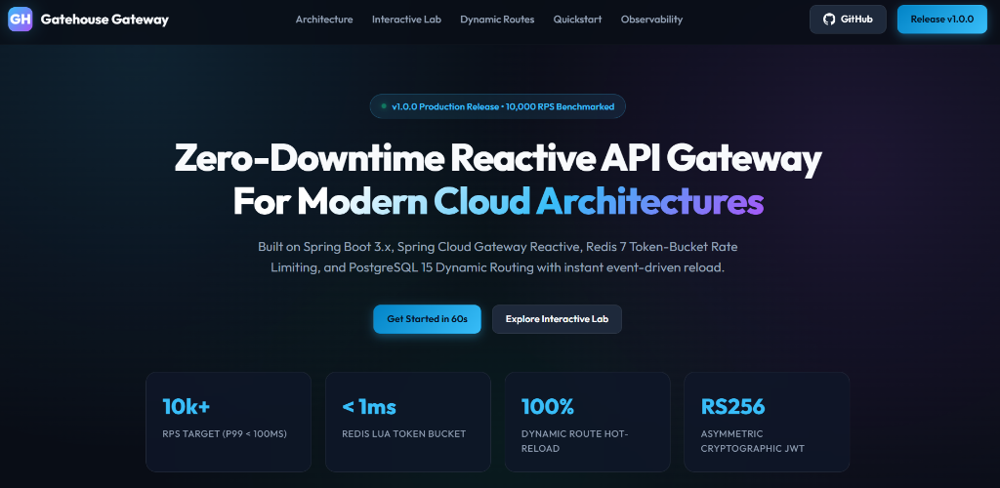

<p align="center">
  
</p>

<h1 align="center">Gatehouse Gateway</h1>

<p align="center">
  <strong>Zero-Downtime Reactive API Gateway for Modern Cloud Architectures</strong><br>
  Built on Spring Boot 3.3, Spring Cloud Gateway Reactive, Project Reactor, Redis 7, and PostgreSQL 15.
</p>

<p align="center">
  <a href="https://crnjihia.github.io/gatehouse-gateway/"></a>
  <a href="https://github.com/crnjihia/gatehouse-gateway/releases/tag/v1.0.0"></a>
  <a href="https://github.com/crnjihia/gatehouse-gateway/actions"></a>
  <a href="https://spring.io/projects/spring-boot"></a>
  <a href="https://spring.io/projects/spring-cloud-gateway"></a>
  <a href="https://redis.io/"></a>
  <a href="https://www.postgresql.org/"></a>
  <a href="LICENSE"></a>
</p>

---

## 📸 Interactive Documentation & Architecture Showcase

Explore the interactive portal featuring dynamic architectural visualizers, live Redis Token-Bucket rate limiting simulators, Resilience4j circuit breaker state transitions, and PCI/PII masking engines:

👉 **[Launch Interactive Documentation Portal](https://crnjihia.github.io/gatehouse-gateway/)**

<p align="center">
  <a href="https://crnjihia.github.io/gatehouse-gateway/">
    
  </a>
</p>

---

## ⚡ High-Throughput Reactive Architecture

Gatehouse Gateway is designed for mission-critical cloud native ecosystems, serving as an intelligent edge layer that decrypts, validates, throttles, inspects, and routes traffic without blocking Netty event loops:

```mermaid
flowchart TD
    Client(["Client / External Caller"])
    
    subgraph Edge ["Gatehouse Gateway (Spring Cloud Gateway Reactive)"]
        JWTIngress["1. JwtValidationGlobalFilter\n(RS256 Cryptographic JWT / SHA-256 API Key)"]
        RateLimiter["2. TokenBucketRateLimitFilter\n(Atomic Redis 7 Lua Script Engine)"]
        TransformFilter["3. RequestResponseTransformationFilter\n(X-Forwarded-*, Correlation ID, PII/PCI Masking)"]
        CircuitBreaker["4. Resilience4j Circuit Breaker\n(Fault Isolation & Auto-Fallback)"]
        AccessLogger["5. GlobalAccessLoggingFilter\n(MDC Structured JSON & Real-time Metrics)"]
    end
    
    subgraph DataPlane ["Persistence & State Plane"]
        Postgres[(PostgreSQL 15\n- Dynamic RouteConfig\n- ApiClient Identities\n- Partitioned RequestLogs)]
        Redis[(Redis 7\n- Token Bucket Counters\n- Daily Quota Tracking\n- Client Cache)]
    end
    
    subgraph ObservabilityStack ["Observability Stack"]
        Prometheus["Prometheus Scraper\n(/actuator/prometheus)"]
        Grafana["Grafana Dashboards\n(RPS, p50/p95/p99, 429s, CB state)"]
    end
    
    subgraph DownstreamServices ["Backend Microservices"]
        UsersSvc["Users Microservice"]
        OrdersSvc["Orders Microservice"]
        PaymentsSvc["Payments Microservice"]
        FallbackEndpoint["/fallback (503 RFC 7807 ProblemDetail)"]
    end

    Client -->|HTTPS Ingress| JWTIngress
    JWTIngress -->|Cache Lookup| Redis
    JWTIngress --> RateLimiter
    RateLimiter -->|Eval Token Bucket| Redis
    RateLimiter --> TransformFilter
    TransformFilter --> CircuitBreaker
    CircuitBreaker -->|Healthy Upstream| DownstreamServices
    CircuitBreaker -->|Timeout / Downstream 5xx| FallbackEndpoint
    DownstreamServices --> AccessLogger
    AccessLogger -->|Async Non-Blocking Append| Postgres
    AccessLogger -->|MDC Counters & Timers| Prometheus
    Prometheus --> Grafana
    Postgres -.->|Hot Reload Without Restart (Event-Driven)| Edge
```

---

## 🚀 Key Architectural Capabilities

### 1. Dynamic Database-Backed Routing (Zero Downtime)
- Route predicates (`Path`, `Method`, `Header`), filters, and destinations (`uri`) are persisted in PostgreSQL as JSONB.
- Routes are polled periodically and hot-reloaded instantly via `POST /admin/routes/reload`.
- Zero dropped connections and zero process restarts.

### 2. Dual-Layer Identity & Cryptographic Authentication
- **RS256 Asymmetric JWT Validation**: Verifies cryptographic signatures, expiration (`exp`), issuer (`iss`), and audience (`aud`).
- **Hashed API Keys**: High-speed lookup with SHA-256 key hashing backed by a sub-millisecond Redis cache.
- Context propagation: Automatically injects downstream context headers (`X-Client-Id`, `X-Client-Scopes`, `X-Request-Id`).
- Unauthorized requests fail fast with RFC 7807 `ProblemDetail` JSON.

### 3. Distributed Redis Token-Bucket Rate Limiter & Quotas
- Executes atomic Redis Lua scripts to evaluate burst limits and daily consumption in a single network round-trip.
- Automatically injects industry standard headers:
  - `X-RateLimit-Limit`: Maximum tokens available in the rolling window.
  - `X-RateLimit-Remaining`: Tokens currently available.
  - `X-RateLimit-Reset`: Milliseconds until token regeneration.
- Excessive requests yield `429 Too Many Requests` with RFC 6585 compliant `Retry-After: 60`.

### 4. PCI-DSS & PII Response Body Sanitization
- Non-blocking response interception executes ahead of Netty response flush (`OrderedGatewayFilter` at order `-2`).
- Automatically masks sensitive payload attributes:
  - `cardNumber`: Sanitized to `****-****-****-5678`.
  - `cvv`: Sanitized to `******`.
  - `password`, `ssn`, `secret`: Sanitized to `********`.

### 5. Resilience4j Fault Isolation & Circuit Breaking
- Monitored upstream routes isolate failing microservices (`slidingWindowSize=20`, `failureRateThreshold=50%`, `waitDurationInOpenState=15s`).
- Unhealthy microservices trigger the fallback endpoint (`/fallback`) returning an RFC 7807 `503 Service Unavailable` error payload.
- Exponential backoff retry policies for idempotent HTTP methods (`GET`, `PUT`, `DELETE`).

### 6. Full Observability & Prometheus/Grafana Dashboards
- Pre-configured Grafana telemetry dashboards (`grafana/dashboards/gatehouse-gateway-dashboard.json`).
- Real-time Prometheus metrics at `/actuator/prometheus`:
  - `gateway.requests.total`: Multi-dimensional counter segmented by `route`, `method`, `status`.
  - `gateway.request.duration`: Latency distribution with p50, p95, and p99 percentiles.
  - `gateway.ratelimit.rejected`: Rate-limit rejections segmented by `clientId`.
  - `gateway.circuitbreaker.state`: Real-time circuit breaker state (`0=CLOSED`, `1=OPEN`, `2=HALF_OPEN`).
- Partitioned PostgreSQL `request_logs` table (partitioned monthly) persisted asynchronously via reactive batching.

---

## 📊 Rate Limit Plan Tiers

| Plan Tier | Minute Burst Rate | Daily Quota Limit | Burst Capacity | SLA / Target Environment |
| :--- | :---: | :---: | :---: | :--- |
| **FREE** | `60 req/min` | `1,000 req/day` | 60 | Sandbox, Evaluation, Developer PoCs |
| **PRO** | `600 req/min` | `100,000 req/day` | 600 | Growth Applications, Production APIs |
| **ENTERPRISE** | `6,000 req/min` | `1,000,000 req/day` | 6,000 | Mission-Critical, High-Volume Workloads |

---

## 🛠️ Quickstart with Docker Compose

Spin up the entire Gatehouse Gateway cluster (Gateway, PostgreSQL 15, Redis 7, WireMock mock downstreams, Prometheus, and Grafana) with a single command:

```bash
docker compose up -d --build
```

### Infrastructure Port Map:

| Service | Port | Description | Credentials / Details |
| :--- | :--- | :--- | :--- |
| **Gatehouse Gateway** | `http://localhost:8080` | Reactive API Gateway | Public Entrypoint |
| **WireMock** | `http://localhost:8081` | Downstream Microservice Stubs | Users, Orders, Payments |
| **PostgreSQL 15** | `localhost:5432` | Dynamic Routes & Identity DB | `gatehouse` / `gatehouse_secret` |
| **Redis 7** | `localhost:6379` | Token Bucket & Quota State | In-memory Lua engine |
| **Prometheus** | `http://localhost:9090` | Timeseries Metrics Engine | Actuator Scraper |
| **Grafana** | `http://localhost:3000` | Operational Telemetry Dashboard | `admin` / `gatehouse` |

---

## 🔒 Client Identity & Onboarding Guide

### 1. Provision an API Client
Register a new API client using the master admin key:

```bash
curl -X POST http://localhost:8080/admin/clients \
  -H "X-Admin-Key: gatehouse-master-admin-key-9988" \
  -H "Content-Type: application/json" \
  -d '{
    "name": "Acme Cloud Platform",
    "ownerEmail": "infra@acme.com",
    "plan": "ENTERPRISE",
    "rateLimitPerMin": 6000,
    "quotaPerDay": 1000000
  }'
```

**Response (Returns raw API key once):**
```json
{
  "id": "10000000-0000-0000-0000-000000000001",
  "name": "Acme Cloud Platform",
  "ownerEmail": "infra@acme.com",
  "plan": "ENTERPRISE",
  "rateLimitPerMin": 6000,
  "quotaPerDay": 1000000,
  "status": "ACTIVE",
  "apiKeyPrefix": "gh_live_a4f2",
  "rawApiKey": "gh_live_a4f2b98721c0498ef1234901ba32ef41",
  "createdAt": "2026-10-17T00:00:00Z"
}
```

### 2. Authenticate Gateway Ingress Requests
Send requests using the raw API key header:
```bash
curl -i -X GET http://localhost:8080/api/v1/users/1001 \
  -H "X-API-Key: gh_live_a4f2b98721c0498ef1234901ba32ef41"
```

Or provide an RS256 Bearer JWT:
```bash
curl -i -X GET http://localhost:8080/api/v1/users/1001 \
  -H "Authorization: Bearer <RS256_JWT_TOKEN>"
```

### 3. Dynamic Route Hot Reloading
To dynamically register or modify routes without restarting the gateway:
```bash
# 1. Insert or update route in PostgreSQL:
INSERT INTO route_configs (route_id, uri, predicates, filters, route_order, enabled, description)
VALUES (
  'payments-v2',
  'http://wiremock:8080',
  '[{"name": "Path", "args": {"pattern": "/api/v2/payments/**"}}]',
  '[{"name": "StripPrefix", "args": {"parts": "2"}}, {"name": "TokenBucketRateLimit", "args": {}}, {"name": "RequestResponseTransformation", "args": {"maskFields": "$.cardNumber,$.cvv"}}]',
  1,
  true,
  'Payments v2 route with PCI body masking'
);

# 2. Trigger instant hot-reload:
curl -X POST http://localhost:8080/admin/routes/reload \
  -H "X-Admin-Key: gatehouse-master-admin-key-9988"
```

---

## 🧪 Testing & Verification

### Run Automated Unit and Integration Tests
```bash
./mvnw clean test
```
The test suite validates:
- **JWT Cryptography**: Expiration, RS256 signature verification, claims forwarding, and public whitelist bypass.
- **Redis Rate Limiting**: Token depletion, 429 status code emission, `Retry-After` header verification, and quota counters.
- **Body Transformation**: PII/PCI masking for card numbers and CVVs without truncating or buffering response streams.
- **WireMock End-to-End**: Gateway routing, circuit breaker trips on downstream simulated outages, and fallback invocation.

### Run Gatling High-Concurrency Performance Benchmark
```bash
./mvnw gatling:test
```
Target SLA criteria:
- **Sustained Throughput**: 10,000 requests per second.
- **Latency**: P99 response time `< 100ms`.
- **Success Rate**: `> 99.0%` non-5xx responses under load.

---

## 🤝 Contributing

We welcome contributions! Please review [CONTRIBUTING.md](CONTRIBUTING.md) for details on our code of conduct, development setup, and pull request guidelines.

---

## 🛡️ Security

For vulnerability disclosure and security policies, please see [SECURITY.md](SECURITY.md).

---

## 📄 License

Gatehouse Gateway is open-sourced under the [Apache License 2.0](LICENSE).
